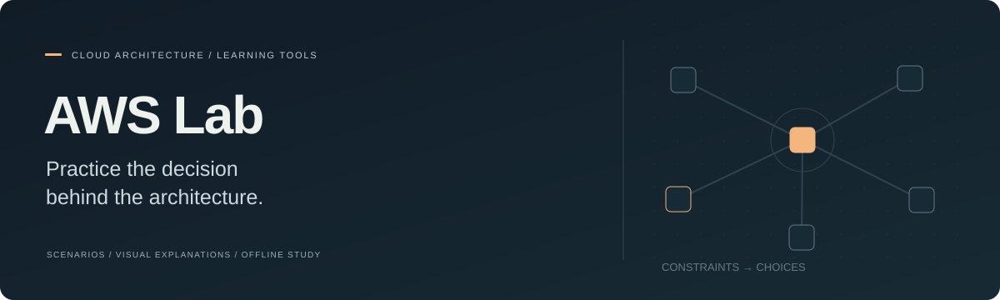

# AWS Lab

[](https://github.com/EssenceSentry/aws-lab/actions/workflows/quality.yml)
[](https://github.com/EssenceSentry/aws-lab/actions/workflows/study-pages.yml)
[](pyproject.toml)
[](https://essencesentry.github.io/aws-lab/)

**Learn cloud architecture by making decisions and seeing their consequences.** AWS Lab pairs an offline study app with a local architecture trainer: practice an exam question, inspect the explanation, then explore what changes when a design constraint moves.

**[Start one question in Waypoint →](https://essencesentry.github.io/aws-lab/)** · [Run the architecture lab](#set-up-and-run-locally) · [Study modes and offline setup](study_app/README.md)

- **A short session or a full rehearsal.** Waypoint supports quick questions, saved questions, mistakes, and timed exam practice on mobile or desktop.
- **Architecture with consequences.** The Streamlit trainer evaluates multi-account designs and explains affected constraints without provisioning AWS resources.
- **Inspectable learning material.** Question data, diagram sources, review evidence, and a pure Python rule engine are available alongside the apps.

The local trainer focuses on the supplied SAP-C02 chapter on organizational complexity. [Source scope and modeling limits](#source-scope-and-limitations) are documented explicitly.

## What is included

- Organization and access design:
  - landing-zone account separation;
  - AWS Organizations and OUs;
  - cross-account roles and federation;
  - SCP allowlist/denylist behavior;
  - Managed Microsoft AD sharing;
  - S3 cross-account access and Requester Pays.
- Multi-account provisioning:
  - CloudFormation StackSets;
  - Service Catalog;
  - service-managed versus self-managed StackSet permissions;
  - the StackSets + Service Catalog combined pattern.
- Multi-VPC and hybrid networking:
  - VPC peering;
  - Transit VPC and Transit Gateway;
  - VPN and VGW patterns;
  - Direct Connect private, public, and transit VIF patterns.
- DNS:
  - DHCP options sets;
  - `enableDnsHostnames` and `enableDnsSupport`;
  - Active Directory DNS and Route 53 Resolver forwarding.
- Fourteen original practice questions and Anki TSV export for mistakes.

## Set up and run locally

Install [uv](https://docs.astral.sh/uv/getting-started/installation/), then
create the project environment with the development dependencies:

```bash
uv sync --extra dev
```

Start the Streamlit app:

```bash
uv run streamlit run app.py
```

Python 3.11 or newer is required. `uv` creates and manages the local `.venv`,
so no manual activation is needed.

In VS Code, you can also run **Tasks: Run Task** from the Command Palette and
select **Start Streamlit app**.

## Run checks

GitHub Actions runs the Python lab's lint, formatting, strict type checks, tests and package build on pushes and pull requests. The study-app workflow also checks the question bank, diagram review evidence, browser interactions and offline image pack.

```bash
uv run pytest
uv run ruff check .
uv run ruff format --check .
uv run pyright
```

## Source scope and limitations

This version is deliberately source-faithful to guide pages 42–58 of the
provided chapter. It does not independently verify the chapter against current
AWS documentation, and it does not silently invent rules for services that are
only named in passing.

Control Tower, Security Hub, detailed consolidated billing, and Reserved
Instance sharing are mentioned in the overview but are not specified enough in
the supplied pages to grade. They are therefore left out rather than guessed.

The IAM/SCP mini-simulator models the basic permission intersection described
in the chapter for a principal in a member account. It intentionally does not
model the full set of resource-policy, service-linked-role, session-policy, or
permissions-boundary edge cases.

## Extending the knowledge base

The reusable engine lives under `src/aws_lab`. Each finding has:

- a stable rule code;
- a severity;
- an explanation;
- a smallest modeled fix;
- a source topic and guide page range.

New chapter sections can be added as another scenario/design dataclass and a
pure evaluation function, then exposed as a new Streamlit tab. The UI is kept
separate from the rule engine so the same evaluator can later power notebooks,
unit tests, a React frontend, or an LLM explanation layer.
